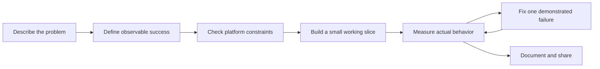

# From Idea to App with AI

A practical playbook for turning an everyday problem into a working app with an AI coding assistant.

**Start with a behavior you can verify. Build one small slice. Test what actually happens. Repeat.**

This repository shares a reusable development method, copyable prompts, project templates, and a complete macOS example: **Volume Mixer**, a native utility that adjusts the local playback volume of individual apps.

The example uses SwiftUI, AppKit, Core Audio, and C. The method also applies to file organizers, menu bar utilities, browser tools, and other small applications. The app itself is macOS-specific.

## Start here

| Your goal | Read this |
| --- | --- |
| Learn the development method | [The workflow](docs/WORKFLOW.md) |
| Copy a prompt into your coding assistant | [Prompt library](prompts/PROMPTS.md) |
| Understand the decisions in this example | [Case study](docs/CASE_STUDY.md) |
| Build and try the reference app | [Volume Mixer](examples/volume-mixer/README.md) |
| Start your own project | [Project brief](templates/PROJECT_BRIEF.md) and [agent instructions](templates/AGENTS.md) |
| Decide whether a feature really works | [Verification record](templates/VERIFICATION.md) |
| See what was checked for this edition | [Publication verification](docs/VERIFICATION.md) |

## The repeatable loop



For example, “make a volume app” leaves too much unspecified. A useful requirement is:

> Let me reduce one app to 25% without changing another app or the system master volume. Pausing or quitting must restore the original playback path.

That sentence gives the assistant a target, constraints, and a way to check its work.

## What this project teaches

1. **Write a short brief before asking for code.** Include the user, platform, essential behavior, and limits.
2. **Test the uncertain capability early.** A polished slider is not evidence that the operating system can deliver the requested control.
3. **Keep changes small enough to inspect.** Each step should end with a runnable result or a specific finding.
4. **Use evidence to drive the next prompt.** Provide reproduction steps, expected behavior, actual behavior, and a small relevant log.
5. **Separate test levels.** A passing unit test does not prove that permissions, devices, or a third-party app work.
6. **Publish the method with the implementation.** Let readers understand the choices and reproduce the checks.

These are lessons reconstructed from the implementation and its verification tools. The prompts are reusable examples, not a verbatim conversation transcript. There is no claim about a particular model, number of prompts, development time, or universal app compatibility.

## The reference app

Volume Mixer discovers audio-producing applications, groups helper processes under their owning app when possible, and provides per-app volume, mute, search, saved settings, and a menu bar entry.

The public example has an English interface and no app-specific presets or preferred messaging app. It processes audio locally in memory and contains no network client or AI API integration. AI assists development; it is not required to run the finished app.

### Build locally

On a Mac with macOS 14.4 or later and compatible Apple Command Line Tools:

```sh
git clone https://github.com/HaomingLyu613/ai-app-building-playbook.git
cd ai-app-building-playbook/examples/volume-mixer
./build.sh
./test.sh
open "dist/Volume Mixer.app"
```

The build produces a locally ad hoc signed application for the current CPU architecture. It is an educational source build, without Developer ID signing or notarization. See the [example README](examples/volume-mixer/README.md) for permissions, limitations, and optional audio checks.

## A first prompt for your own app

```text
I want to build a small app for [user] that solves [problem].
Platform: [platform].
The first version must: [up to three observable behaviors].
Constraints: [privacy, dependencies, performance, compatibility].
Success means: [an outcome I can reproduce and check].

Inspect the project first. Identify the most uncertain platform capability
and propose a small experiment to validate it. Then implement the smallest
useful slice within this scope, run the relevant checks, and explain what
the evidence proves and what still needs a real-world test.
```

Replace every bracketed field. More task-specific context is usually more useful than a longer list of generic instructions. OpenAI's [official prompting documentation](https://learn.chatgpt.com/docs/prompting#prompting-codex) likewise recommends describing desired behavior, relevant context, constraints, and verification.

## Contributing and reuse

Improvements to the workflow, reproducible bug reports, and additional small examples are welcome. Include your environment, exact steps, expected and actual behavior, and verification results. Remove personal data from logs before posting them.

Code, documentation, and templates are available under the [MIT License](LICENSE).
