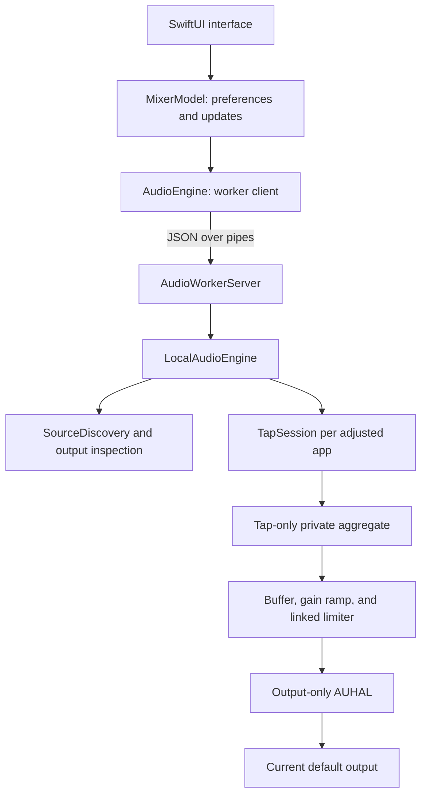

# Case study: a general-purpose per-app volume utility

## The problem

Several applications can play audio at once, while the system volume control affects the overall output. This example provides a separate local playback setting for each discovered audio application.

The implementation is shared as a concrete case for AI-assisted development. This account is based on the available source and verification tools. It does not reconstruct an exact conversation or claim a fixed development time.

## Version boundary

The current source is the experimental 0.2.0 candidate. The downloadable standalone 0.1.0 release uses the earlier UI and audio path. A passing report belongs to the version and environment that produced it; it does not validate a later backend rewrite. Shared-backend development measurements are recorded separately; this English bundle still needs a real-audio run.

The [current interface preview](assets/interface-preview.png) is a native SwiftUI render explicitly labeled sample data. It demonstrates the visual design, not the listed apps' audio compatibility.

## The architecture visible in the code

The client `AudioEngine` lives in `AudioWorker.swift`; the audio-owning `LocalAudioEngine` lives in `AudioEngine.swift`. The distinction matters when tracing failures.

| Files in `examples/volume-mixer/` | Responsibility |
| --- | --- |
| `Sources/MixerView.swift`, `MixerModel.swift` | Controls, visible status, saved settings, coalesced updates |
| `Sources/AudioWorker.swift` | Worker lifecycle, JSON protocol, bounded requests and termination |
| `Sources/CoreAudioSupport.swift` | Core Audio helpers and audio-process discovery |
| `Sources/AudioEngine.swift` | Source reconciliation, device changes, session health and retries |
| `Sources/TapSession.swift` | Process tap, tap-only capture aggregate, output-only AUHAL, callback ownership and cleanup |
| `Sources/AudioDSP.c` | Sample scaling, 30 ms ramp, linked limiter, validation and counters |
| `Sources/AudioTransport.c` | Preallocated SPSC FIFO, clock bridging, linear resampling and bounded drift correction |
| `Sources/*Verification.swift`, `Tests/` | Checks at different levels |

## Decisions readers can reuse

### Discover capability instead of hardcoding a favorite app

The public version identifies audio processes and tries to group helpers under an owning application. Playing apps sort ahead of idle entries; names break ties. It contains no messaging-app identity check, preferred ordering, or named-app preset.

The general lesson is to model the capability the user needs. A file utility should classify supported files by relevant attributes; an audio utility should discover audio sources.

### Confirm data before taking over

The app verifies capture using a generated signal. A channel must receive valid, nonzero audio before its processing path takes over the original signal. This guards against a permission or routing condition that creates callbacks but delivers silence.

The transferable lesson is to check useful output as well as API status. A successful HTTP request, database connection, or device handle can still produce the wrong result.

### Isolate operations that may hang

The UI communicates with a separate audio worker instead of issuing audio HAL calls itself. The client can bound a request, cancel setup, or stop its own worker when the integration does not respond.

`WorkerVerification.swift` uses mock worker modes for unanswered requests, cleanup timeouts, crashes, and launch failures. It also checks that 1,001 slider updates preserve the final 37% setting without producing 1,001 scans.

### Measure the behavior through a separate path

Internal input/output buffers help verify gain math. They do not fully establish the signal that reaches a later stage of the audio path.

`OutputVerification.swift` and `ChromeVerification.swift` use additional capture paths and a native baseline measured by the same method. Their measurements are digital signals, not acoustic loudness. No microphone recording is involved.

### Make recovery part of the feature

At 100%, the engine releases the processing session and returns to the native audio path. Pause and quit also request cleanup. Session failures retain ownership information so failed cleanup is not silently forgotten; the worker client handles a nonresponsive shutdown with a deadline.

This is a useful pattern for utilities that temporarily own resources. Success includes returning those resources to the system.

### Treat the slider and signal as separate representations

The source candidate stores real amplitude percentages from 0% to 200%. Its shaped slider places unity at 75% travel and leaves the final quarter for boost. A 30 ms ramp smooths gain changes; a linked stereo limiter reduces peaks with one shared factor. The visual mapping improves adjustment space without relabeling a signal's gain. A 200% setting requests 2× amplitude before limiting, not twice the perceived loudness.

### Trace a reported side effect before claiming isolation

A report that outgoing voice becomes quieter is useful evidence even if the intended feature only controls playback. Inspect the actual resource topology rather than relying on that intention. The revised path separates tap-only capture from an output-only AUHAL renderer, disables physical input I/O, and neither captures a microphone nor sets its gain. This separation adds a buffer target of approximately 20 ms plus other device latency.

Read-only hardware input snapshots answer a narrow question: did the selected properties change? They do not establish that conferencing echo cancellation, automatic gain control, or the voice heard at the other end is unchanged. Keep actual calls and Bluetooth marked unvalidated until those sessions occur. Ask the human tester to check both what they hear and what a remote listener hears.

### Debug the earliest demonstrated failure

Log the start and completion of each operating-system operation, with elapsed time and error status. A timeout during cleanup can be a consequence of an earlier blocked operation, not its root cause. Use an independent read-only probe to distinguish a stuck app worker from a broader control-path problem; stop the affected client before queuing repeated retries. Do not publish private device identifiers or local paths from these logs.

The transferable lesson is to preserve the chain from observation to hypothesis to experiment. State which explanation remains unproven. Generated signals and mock-worker tests help narrow a failure; a successful synthetic test still needs the original human reproduction.

## What changed for publication

- All authored interface text, errors, fixture text, and documentation are English.
- App-specific naming, prioritization, and the two-app preset were removed.
- The example has its own bundle identifier and preferences domain.
- Build output, local verification reports, personal paths, and original chat history are excluded.
- The repository explains what each check proves and provides commands to repeat it.

The reference remains a source-build example. A fresh OS permission grant is needed for its distinct app identity. Broad third-party app and device compatibility is not established by compilation or mock tests.

## Further reading

- [Apple: Capturing system audio with Core Audio taps](https://developer.apple.com/documentation/coreaudio/capturing-system-audio-with-core-audio-taps) — the platform reference for this example's capture mechanism.
- [OpenAI: Prompting Codex](https://learn.chatgpt.com/docs/prompting#prompting-codex) — official guidance for expressing a coding task with behavior, context, constraints, and verification.
- [The reusable workflow](WORKFLOW.md) — the process to adapt to another app.
