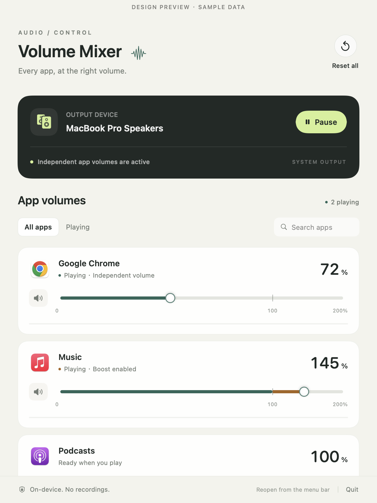

# Volume Mixer

A native macOS reference app for independent local playback volume. Built with SwiftUI, AppKit, Core Audio process taps, and a small C audio processor.

This example accompanies the [AI app-building playbook](../../README.md). It has no preferred messaging app or app-specific preset. It is an educational source build with a general-purpose interface.

## Current source status

This is the **experimental 0.2.0 source candidate**, not a newly published binary. The [standalone 0.1.0 download](https://github.com/HermanLL66/mac-volume-mixer/releases/tag/v0.1.0) remains an earlier 0–100% build. Shared-backend development measurements are recorded separately; real audio for this English bundle remains pending; previous compilation, mock checks, and historical audio results do not validate it.



The image is a layout render using sample data, not evidence that the displayed apps or a real call were tested.

## Requirements and build

- macOS 14.4 or later.
- Apple Command Line Tools with Swift and an SDK containing the required Core Audio tap APIs.
- Mono or stereo output. The script builds for the current machine's CPU architecture.

From this directory:

```sh
./build.sh
./test.sh
open "dist/Volume Mixer.app"
```

Output: `dist/Volume Mixer.app` and `dist/Volume Mixer.zip`. No third-party runtime dependencies or AI API key are needed. The scripts ad hoc sign the bundle and verify its signature locally. Developer ID signing and notarization are separate distribution steps and are not configured here.

## Use

1. Start playback in an application so it can be discovered.
2. Open Volume Mixer, click **Enable**, and grant system audio access if macOS asks. Initial verification plays a very quiet generated tone.
3. Set an app's slider between 0% and 200%, or use its speaker button to mute it. Settings are saved automatically. 100% is unity and sits at 75% of slider travel; the final quarter is the boost range.
4. Use **Pause** to release processing while retaining preferences. **Reset all** restores all saved settings to 100% and unmutes them.
5. Close the window to keep the app in the menu bar. **Quit** releases the app's audio resources.

If verification cannot receive audio, check System Settings > Privacy & Security > Screen & System Audio Recording. Some OS versions label this Screen Recording. Enable access for Volume Mixer and retry; quit and reopen if macOS requests it.

This public example uses a distinct bundle identifier and does not reuse another edition's saved settings or permission identity. App names come from the OS and may appear in the user's system language.

## Scope

- Targets local playback. The backend uses tap-only private aggregate capture and a separate output-only AUHAL with physical input I/O disabled. It does not capture a microphone or set its gain.
- The read-only input-state checks do not establish unchanged conferencing echo cancellation, automatic gain control, or remote voice level. Real calls and Bluetooth have not been validated.
- Groups an app's helper processes when an owning application can be identified.
- Browser tabs share an application volume.
- Follows the default output device without replacing it or changing hardware master volume.
- At 100%, returns the application to its original playback path.
- Processes audio in local memory without saving or uploading audio.
- Uses a 30 ms gain ramp and linked stereo peak limiting. 200% requests 2× amplitude before limiting, not twice the perceived loudness.
- Separating capture and rendering adds a buffer target of approximately 20 ms, plus hardware and scheduling latency.

Protected media, exclusive devices, unusual formats, and special-purpose processes may be unsupported. Support must be checked with the actual app, OS version, and output device. Digital gain ratios do not directly measure perceived or acoustic loudness.

## Verification

**English-bundle real-audio checks are pending.** Shared-backend local development results are recorded separately. Run the commands below to collect version-specific evidence; their presence is not a passed result. Test the new gain range and limiter with controlled signals and headroom, then test overload, independent channels, idle/resume, cleanup, and buffering. Actual call listening must be checked separately.

Quit other instances of this example before running an app-based diagnostic. Create the output directory first. Diagnostics save JSON reports; inspect `passed`, error/reason fields, and cleanup results instead of relying only on process exit status.

### Fast checks without real audio

```sh
./test.sh
mkdir -p output
"./dist/Volume Mixer.app/Contents/MacOS/VolumeMixer" --verify-worker "$PWD/output/worker-verification.json"
python3 -m json.tool output/worker-verification.json
```

The DSP tests use AddressSanitizer and UndefinedBehaviorSanitizer for gain, mute, smoothing, invalid samples, buffer bounds, and input isolation. The worker check uses mock processes for protocol round trips, timeouts, cancellation, cleanup hangs, crashes, launch failure, and rapid slider changes. These checks do not prove actual audio routing.

### Optional checks using real audio

These checks create quiet temporary audio signals and may request system audio access. Run one at a time and wait for the app to finish and exit before starting another.

The audio check exercises independent gain and mute through real processing buffers:

```sh
open -n "dist/Volume Mixer.app" --args --verify-audio "$PWD/output/audio-verification.json"
```

After that check exits, the engine check covers idle/resume, process restart and replacement, gain changes, cleanup, and hardware-state snapshots:

```sh
open -n "dist/Volume Mixer.app" --args --verify-engine "$PWD/output/engine-verification.json"
```

After the engine check exits, the output check compares an independent capture of replayed audio with a native baseline obtained by the same method:

```sh
open -n "dist/Volume Mixer.app" --args --verify-output "$PWD/output/output-verification.json"
```

### Optional Chrome integration example

This specific integration test is retained as one concrete third-party app check. It is not a claim that all browsers have been tested.

Open `Tests/BrowserAudio.html` in Chrome and click **Start test tone**. Keep it playing, with no other Chrome media active. Then run:

```sh
open -n "dist/Volume Mixer.app" --args --verify-chrome "$PWD/output/chrome-verification.json"
```

The check temporarily applies 50%, 25%, 150%, 200%, and mute to a quiet Chrome fixture, holds 50% for at least 60 seconds, compares independently captured digital output with its original baseline, then checks restoration and cleanup. Stop the fixture afterward.

### Inspect discovery

```sh
"./dist/Volume Mixer.app/Contents/MacOS/VolumeMixer" --list-audio
```

Discovery output may identify apps running on your machine. Review and redact it before posting publicly. Private taps may only be visible to their creator, so another process's empty tap list cannot prove cleanup.

## Source map

Read the [case study](../../docs/CASE_STUDY.md) for the component map and engineering lessons. Apple's [Core Audio taps documentation](https://developer.apple.com/documentation/coreaudio/capturing-system-audio-with-core-audio-taps) describes the platform mechanism used here.
